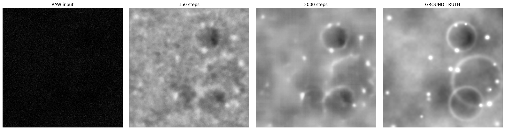

# Lunar PSR Enhancement

Deep-learning pipeline that recovers detail from **Permanently Shadowed Regions (PSRs)** of lunar craters — areas that never see direct sunlight, so cameras capture almost nothing but noise.

Built for **Smart India Hackathon 2026** (problem statement SIH1732, Space Technology). Cleared the university internal qualifier.



*Left to right: raw dark input → U-Net output after 150 steps → after 2000 steps → ground truth.*

## The problem

A PSR has never been sunlit, so no bright "answer" image of it exists to train on. This pipeline **manufactures its own training data**: it generates sunlit craters, darkens them with a physics-based camera noise model, and trains a U-Net to undo the darkening.

## Results

Single NVIDIA T4 GPU (Google Colab), 150 training steps, held-out frame:

| | PSNR | SSIM |
|---|---|---|
| Raw dark input vs. truth | 4.8 dB | 0.06 |
| **Enhanced output vs. truth** | **21.2 dB** | **0.66** |
| Improvement | **+16.4 dB** | **+0.61** |

The raw-input row is the "do nothing" baseline, so the gain is the model's doing. Longer training (2000 steps, image above) recovers crater rims and individual boulders.

## How it works

| # | Stage | Module | What it does |
|---|---|---|---|
| 1 | Data synthesis | `src/data_mock.py` | Procedural sunlit craters: fractal noise terrain, lit crater rims, boulders |
| 2 | Physics-based degradation | `src/degrade.py` | Illumination scaling (1–8%), secondary-light gradient, Poisson shot noise, Gaussian read noise, ADC quantisation → (dark, bright) pairs |
| 3 | Training | `src/train.py` | Compact U-Net (1.9M parameters), L1 loss, Adam; pairs synthesised on the fly |
| 4 | Inference | `src/infer.py` | Raw low-light image → brightened, denoised output |
| 5 | Validation | `src/validate.py` | PSNR and SSIM against ground truth, with the raw-input baseline |

## Quick start

```bash
bash setup.sh                 # virtualenv + PyTorch, OpenCV, NumPy/SciPy, rasterio
source .venv/bin/activate     #   (GPU=1 bash setup.sh for the CUDA build)
bash run_demo.sh              # all 5 stages end-to-end, prints PSNR/SSIM
```

Longer training run for sharper results:

```bash
python -m src.train    --steps 2000 --batch 8 --patch 128
python -m src.infer    --ckpt checkpoints/unet.pt --in data/pairs/dark/sunlit_000.png --out outputs/enhanced_hq.png
python -m src.validate --pred outputs/enhanced_hq.png --target data/pairs/bright/sunlit_000.png --baseline data/pairs/dark/sunlit_000.png
```

**On Google Colab:** Runtime → Change runtime type → T4 GPU, upload the repo, then run `!pip -q install rasterio` and `!bash run_demo.sh`.

## Scope and next steps

All results are on **synthetic data**, deliberately: PSNR/SSIM need a ground-truth image, which never exists for a real PSR. The degradation model follows the published HORUS approach (below).

Only stage 1 changes to use real imagery — **Chandrayaan-2 OHRC** (ISRO PRADAN) or **LRO LROC NAC** (NASA PDS), read with `rasterio` and tiled into patches. On real PSRs, evaluation moves to no-reference metrics (NIQE/BRISQUE) and terrain-consistency checks against LOLA elevation data.

## References

- Bickel, Moseley et al., *Peering into lunar permanently shadowed regions with deep learning*, Nature Communications, 2021 (HORUS)
- Moseley et al., *Extreme low-light environment-driven image denoising over permanently shadowed lunar regions with a physical noise model*, CVPR, 2021
- Ronneberger et al., *U-Net*, MICCAI, 2015
- Wang et al., *Image quality assessment: from error visibility to structural similarity* (SSIM), IEEE TIP, 2004


